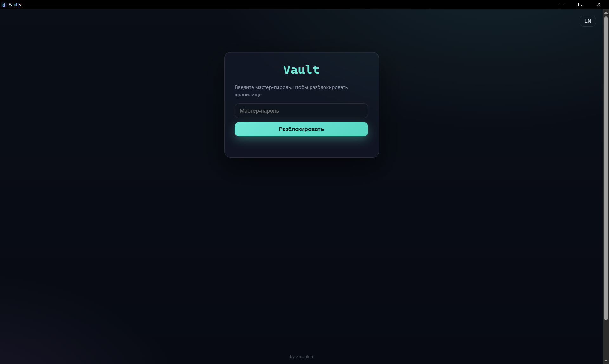
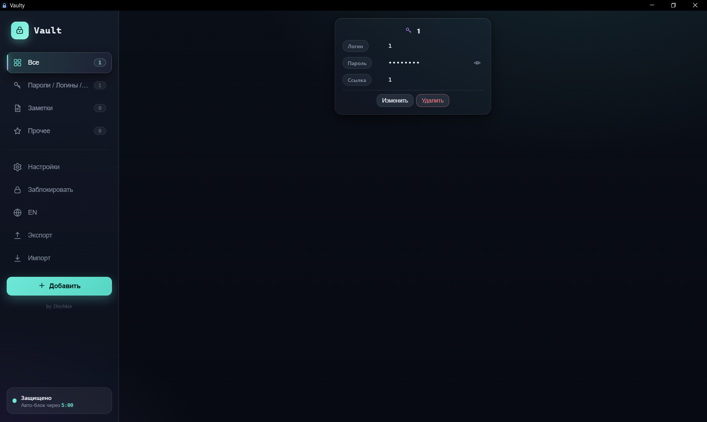
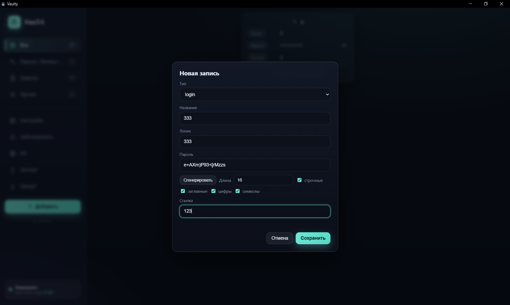
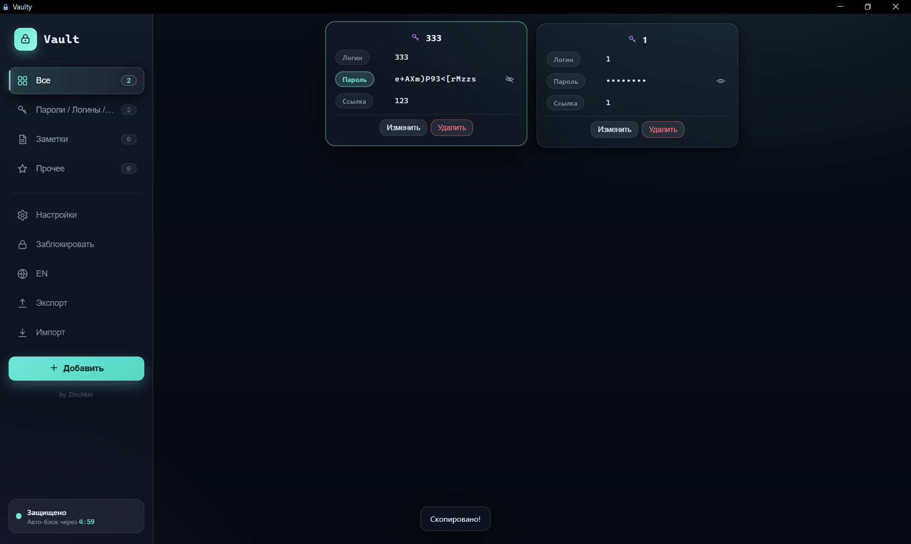
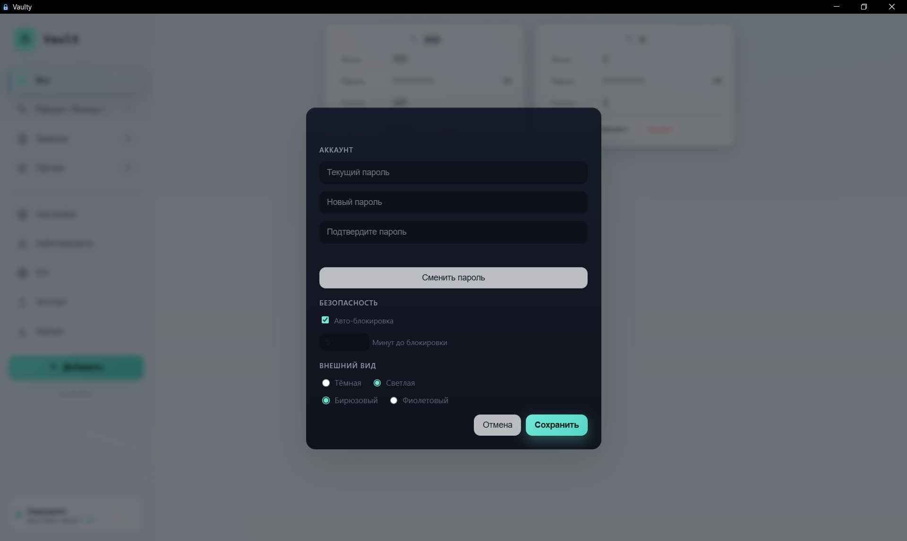

# Vault

A **local, offline password manager** built with [Tauri v2](https://v2.tauri.app/) (Rust) and a vanilla TypeScript + [Vite](https://vitejs.dev/) frontend. No network, no cloud, no telemetry — your vault never leaves your machine.

> Application name: **Vault**. The repository and installers are named `Vault` / `Vault_*.exe`; the internal Rust crate is kept as `vaulty` for storage compatibility.

## Download

A ready-to-use Windows (x64) installer is committed in the repo:

- **`releases/Vault_0.1.0_x64-setup.exe`** — [direct download](https://github.com/zhichkin44-del/Vault/raw/main/releases/Vault_0.1.0_x64-setup.exe) · NSIS installer, ~1.2 MB.

1. Download `Vault_0.1.0_x64-setup.exe`.
2. Run it (double-click). It installs **Vault** to your user profile and creates a **Vault** shortcut.
3. On first run, create a vault with a master password.

> **Unsigned build.** The installer is not code-signed, so Windows SmartScreen / Microsoft Defender may warn that the publisher is unknown. That is expected — choose *Run anyway* / *More info → Run* if you trust this source. The app makes no network connections.

## Features

- **Encrypted at rest** — the vault is stored encrypted with AES‑256‑GCM; the key is derived from your master password using **Argon2id** (600k iterations).
- **Encrypted export / import** — backups are written as `.vault` files that are *also* encrypted (same format, unlocked only with the master password). Exports are **never** plaintext.
- **Master‑password only** — no accounts, no sync.
- **Entries** — title, type, login, password, URL, custom fields, notes.
- **Password generator** built into the entry editor.
- **Auto‑lock** after inactivity (configurable, can be turned off).
- **Multilingual** UI: Russian / English.
- **Appearance** — light/dark theme and teal/purple accent.
- **Sidebar** navigation, settings (change master password, auto‑lock, appearance), and an unobtrusive author credit (`by zhichkin44-del`).

## Security model

| Property | Behavior |
| --- | --- |
| Network | None. The app makes no outbound connections. |
| Storage | Encrypted blob in the webview's local storage. |
| Encryption | AES‑256‑GCM (authenticated). |
| Key derivation | Argon2id (memory‑hard KDF). |
| Export file | Encrypted `.vault`; requires the master password to re‑import. |
| Telemetry | None. |

The master password is the only secret. There is no recovery — if you forget it, the vault cannot be decrypted.

## Screenshots

| | |
| --- | --- |
|  |  |
|  |  |
|  | |

## Project structure

```
vault/
├── index.html              # Vite entry
├── package.json            # scripts: build, tauri, test
├── vite.config.ts
├── tsconfig.json
├── .gitignore
├── README.md
├── LICENSE
├── screenshots/           # README images
├── src/                  # TypeScript frontend (vanilla, no UI framework)
│   ├── main.ts            # entry point
│   ├── app.ts            # app shell, render loop, auto‑lock
│   ├── lock.ts           # lock / unlock screen
│   ├── sidebar.ts        # sidebar (nav, actions, settings, language, credit)
│   ├── editor.ts         # create / edit entry modal
│   ├── settings.ts        # settings state (auto‑lock, theme, accent)
│   ├── settingsModal.ts   # settings modal (change master password, auto‑lock, appearance)
│   ├── confirm.ts         # confirm modal
│   ├── vault.ts          # Vault model + seal/open (AES‑GCM)
│   ├── vaultio.ts        # serialize/deserialize .vault files (VAULTY1 magic)
│   ├── storage.ts        # storage backend (localStorage / memory)
│   ├── crypto.ts         # Argon2id KDF + AES‑GCM
│   ├── i18n.ts           # ru / en strings
│   ├── state.ts          # app state (incl. derived‑key cache)
│   ├── exportimport.ts    # encrypted export / import
│   ├── types.ts
│   └── styles.css
├── src-tauri/           # Rust + Tauri v2
│   ├── Cargo.toml
│   ├── tauri.conf.json   # product name, window, bundle, icon
│   ├── capabilities/
│   │   └── default.json # dialog + filesystem permissions
│   ├── icons/
│   ├── src/
│   │   ├── main.rs
│   │   └── lib.rs        # plugin wiring (fs, dialog)
│   └── target/            # build output (git‑ignored)
└── test/                 # Deno unit tests
    ├── crypto.test.ts
    ├── vaultio.test.ts
    ├── storage-reseal.test.ts
    ├── i18n.test.ts
    └── t13-keycache.test.ts
```

## Build & run

### Prerequisites

- [Node.js](https://nodejs.org/) + npm
- [Rust](https://www.rust-lang.org/) (stable) with `cargo`
- [Tauri v2 prerequisites](https://v2.tauri.app/start/prerequisites/) — on Windows, the MSVC build tools (Visual Studio Build Tools) are required to compile the Rust binary
- [Deno](https://deno.com/) (for the unit tests)

### Development

```bash
npm install
npm run tauri dev
```

### Release build (Windows installer)

```bash
npm run build        # Vite frontend build
npm run tauri build  # compiles Rust + bundles the NSIS installer
```

The installer is produced at:

```
src-tauri/target/release/bundle/nsis/Vault_0.1.0_x64-setup.exe
```

A copy is also committed under `releases/` so it can be downloaded directly from the repository.

### Tests & type check

```bash
npm test              # Deno unit tests (crypto / vaultio / storage / i18n)
npx tsc --noEmit    # TypeScript type check
```

## License

[MIT](LICENSE) © 2026 zhichkin44-del.
