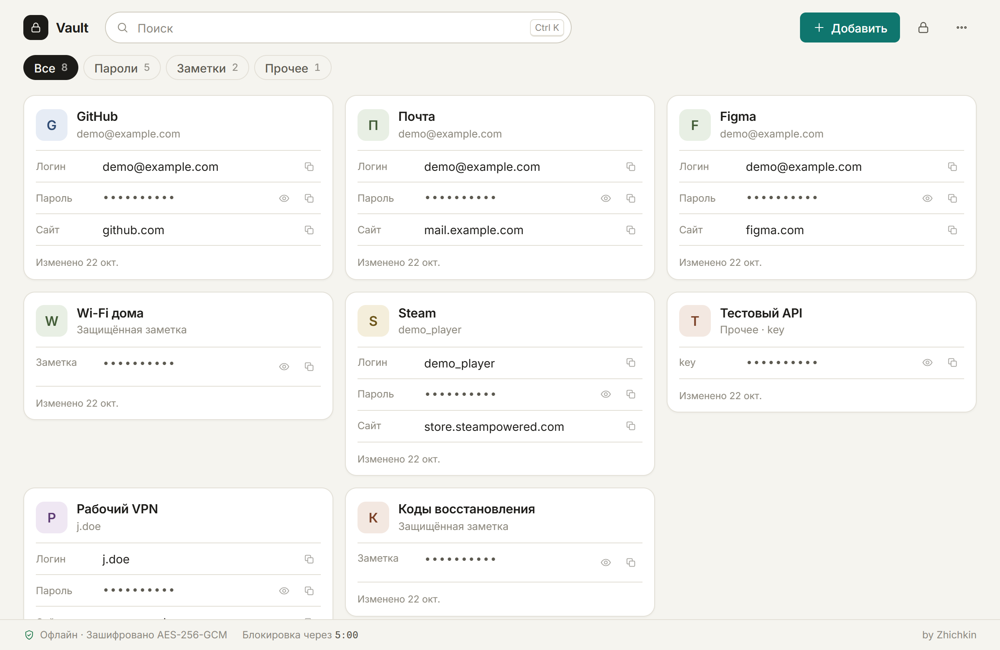
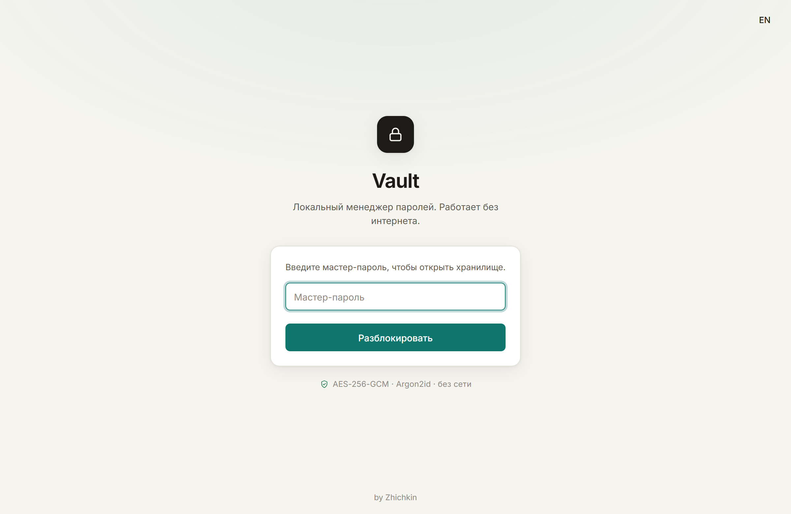
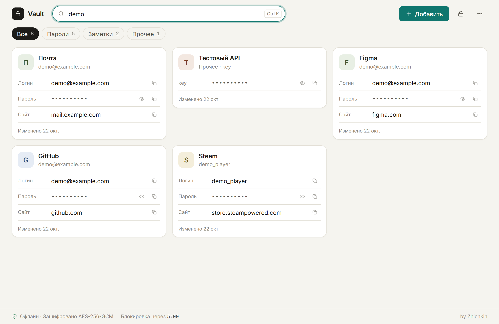
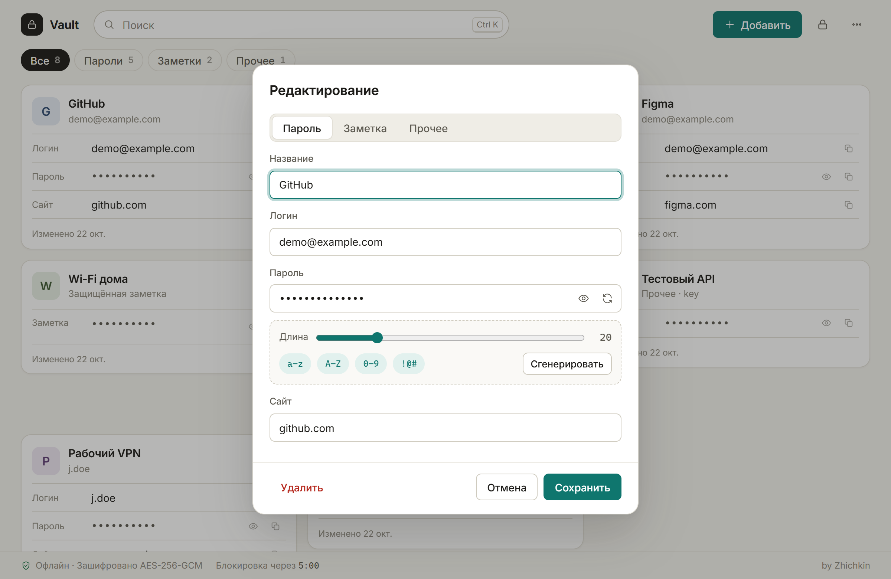
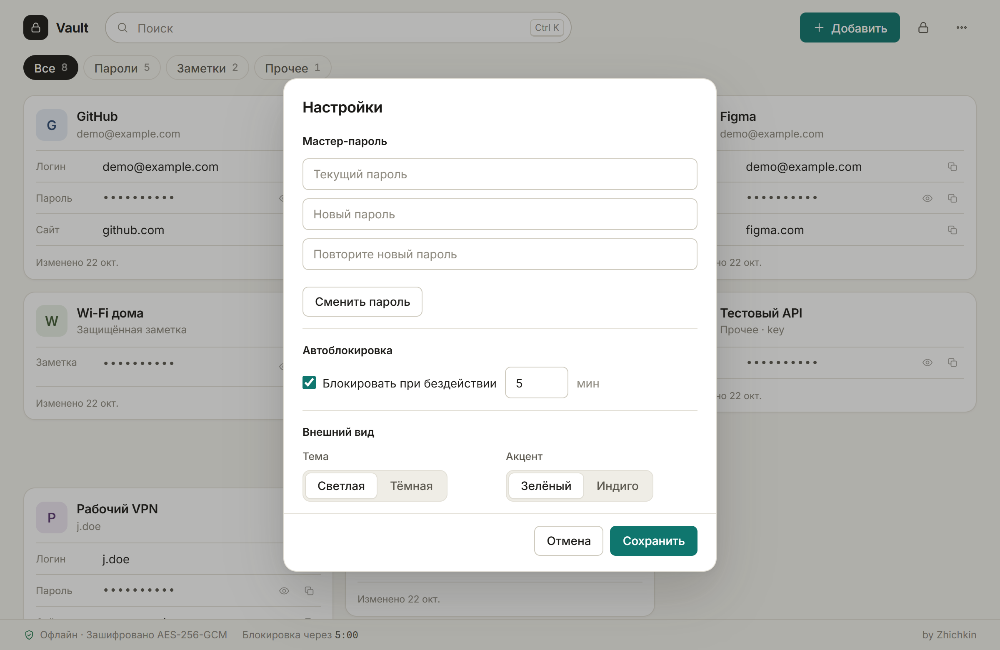
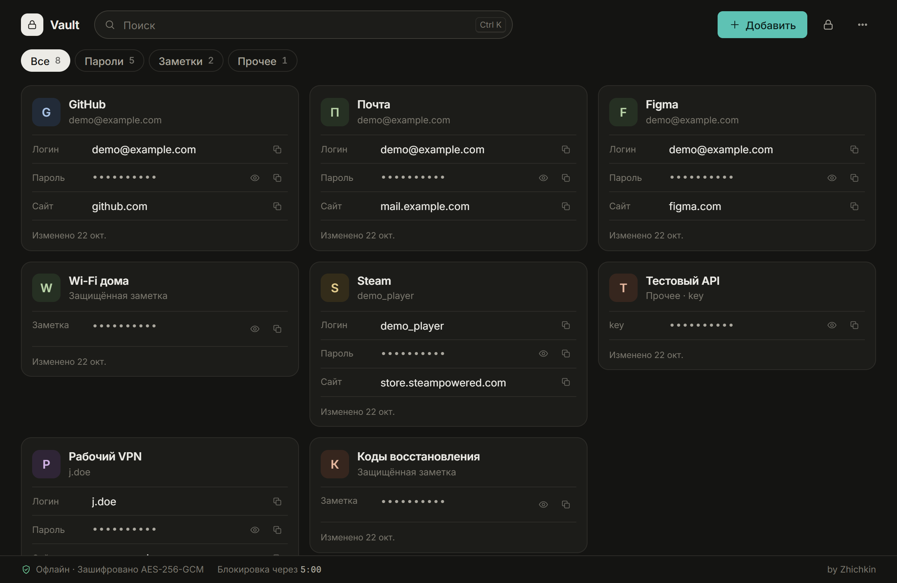
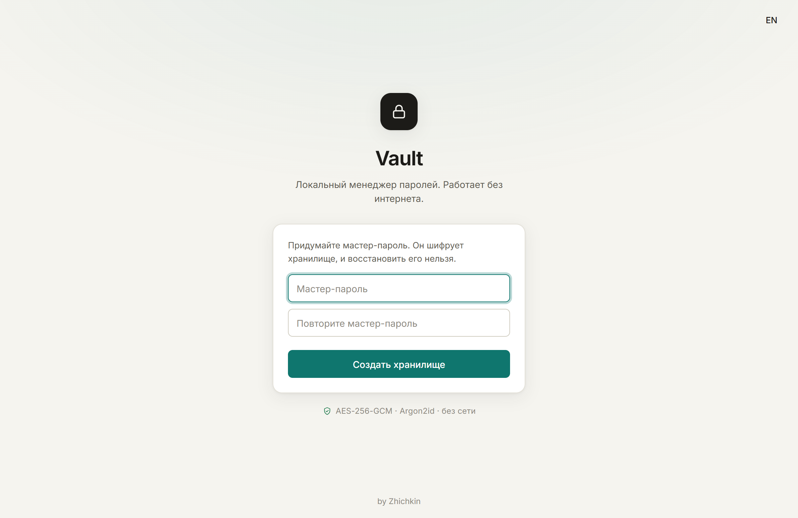

# Vault

A **local, offline password manager** for one person. Built with [Tauri v2](https://v2.tauri.app/) (Rust) and a vanilla TypeScript + [Vite](https://vitejs.dev/) frontend. No network, no cloud, no account, no telemetry: your vault never leaves your machine.



*Screenshots show the Russian interface with made-up demo data; English is one click away (the language item in the ⋯ menu).*

## Download

Ready-to-run files are attached to [Releases](https://github.com/zhichkin44-del/vault-offline/releases):

| Platform | File | Notes |
| --- | --- | --- |
| Windows 10/11 (x64) | `Vault_<version>_x64-setup.exe` | NSIS installer, installs per user |
| Windows 10/11 (x64) | `Vault_<version>_x64-portable.exe` | No installation: put it anywhere and run. Use it when SmartScreen or Smart App Control blocks the installer |
| macOS 10.15+ (Intel and Apple Silicon) | `Vault_<version>_universal.dmg` | Built on demand by the Release workflow (see below) |

The installer and the portable app keep the vault in the same place (your user profile's app data folder), so you can switch between them.

> **Unsigned builds.** Code-signing certificates cost money, so the installers aren't signed.
> - **Windows:** SmartScreen may say the publisher is unknown → *More info → Run anyway*.
> - **macOS:** the first launch is blocked → open *System Settings → Privacy & Security* and click *Open Anyway* (or right-click the app → *Open*).
>
> Vault makes no network connections, so it never phones home. If you'd rather not trust a binary, [build it yourself](#build-and-run).

Version 0.2 migrates a vault from 0.1 automatically on first start.

## Features

- **Strong encryption at rest:** AES‑256‑GCM, with the key derived from your master password by **Argon2id** (64 MiB memory, 3 passes).
- **Crash-safe storage:** atomic saves, and the previous version is kept as a backup file.
- **Search** across titles, logins, websites, notes and fields (`Ctrl+K`).
- **Entries:** passwords (login, password, website), secure notes, and custom fields such as API keys or PINs.
- **Password generator** with length and character-set controls.
- **One-click copy.** The clipboard is cleared after 15 seconds.
- **Encrypted backups:** export to a `.vault` file; import either merges into your vault or replaces it.
- **Auto‑lock** after inactivity (configurable), `Ctrl+L` to lock now.
- **Light and dark themes**, green or indigo accent, Russian / English UI.

## Security model

| Property | Behavior |
| --- | --- |
| Network | None, enforced by a strict Content Security Policy. No sync, telemetry or update checks. |
| Storage | `vault.vault` in your user profile's app data folder, ciphertext only, plus `vault.vault.bak`. |
| Encryption | AES‑256‑GCM (authenticated), fresh random IV on every save. |
| Key derivation | Argon2id, 64 MiB memory, 3 passes, random 16‑byte salt. |
| In memory | Derived non-extractable key only; the master password isn't kept. |
| Export file | Encrypted `.vault`; needs the master password to import. |

The master password is the only secret. There is no recovery: if you forget it, the vault can't be decrypted.

Vault is single‑user and offline **by design**: no sharing, no cloud, no browser autofill. See **[SECURITY.md](SECURITY.md)** for the full threat model: what Vault protects against, what it deliberately doesn't do, and what it can't protect against.

## Screenshots

| | |
| --- | --- |
|  |  |
|  |  |
|  |  |

## Project structure

```
vault/
├── index.html               # Vite entry
├── public/favicon.svg
├── src/                     # TypeScript frontend (vanilla, no UI framework)
│   ├── main.ts              # boot: picks storage, migrates v0.1 data
│   ├── app.ts               # app shell, shortcuts, auto-lock
│   ├── lock.ts              # create / unlock screen
│   ├── topbar.ts            # search, add, lock, menu, category chips, status bar
│   ├── grid.ts, card.ts     # entry cards (copy, reveal)
│   ├── editor.ts            # create / edit entry, password generator
│   ├── settingsModal.ts     # master password, auto-lock, appearance
│   ├── exportimport.ts      # encrypted export, import (merge / replace)
│   ├── crypto.ts            # Argon2id / PBKDF2 + AES-GCM, KDF bounds
│   ├── vault.ts             # vault model, seal / open, merge
│   ├── vaultio.ts           # .vault file format (VAULTY1 header)
│   ├── storage.ts           # file storage via Rust, legacy localStorage, migration
│   ├── state.ts             # session state (derived key only)
│   ├── i18n.ts, icons.ts, dom.ts, styles.css
├── src-tauri/               # Rust + Tauri v2
│   ├── src/lib.rs           # vault_exists / vault_read / vault_write (atomic) + tests
│   ├── tauri.conf.json      # window, CSP, bundle
│   └── capabilities/        # dialog + picked-file permissions
├── test/                    # node:test unit and UI smoke tests (via tsx + jsdom)
└── .github/workflows/release.yml
```

## Build and run

### Prerequisites

- [Node.js](https://nodejs.org/) 20+ with npm
- [Rust](https://rustup.rs/) (stable)
- [Tauri v2 prerequisites](https://v2.tauri.app/start/prerequisites/). On Windows that's the Visual Studio Build Tools (Desktop development with C++) and WebView2, which is built into Windows 11.

### Development

```bash
npm install
npm run tauri dev
```

### Installer

```bash
npm run tauri build
```

The Windows installer is written to `src-tauri/target/release/bundle/nsis/`.

### Tests

```bash
npm test                              # unit + UI smoke tests
npm run typecheck                     # TypeScript
cargo test --manifest-path src-tauri/Cargo.toml   # Rust storage tests
```

### Releases (free, unsigned)

Windows files are built locally (`npm run tauri build`) and uploaded to a GitHub release:

```bash
gh release create v0.2.0 --title "Vault 0.2.0" --notes "..." \
  "src-tauri/target/release/bundle/nsis/Vault_0.2.0_x64-setup.exe" \
  "Vault_0.2.0_x64-portable.exe"   # a copy of src-tauri/target/release/vaulty.exe
```

The **Release** workflow (*Actions → Release → Run workflow*, manual only) builds Windows and macOS installers on GitHub-hosted runners and attaches them to the run. It runs only on demand, not on every tag.

## License

[MIT](LICENSE) © 2026 Zhichkin. Third-party components and their licenses: [THIRD_PARTY_NOTICES.md](THIRD_PARTY_NOTICES.md).
